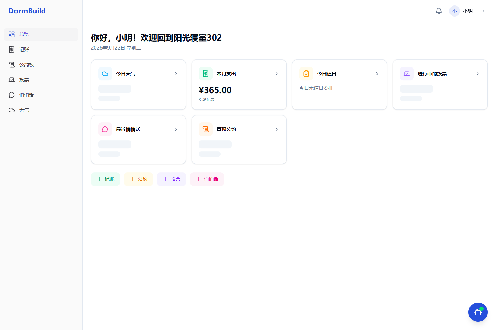
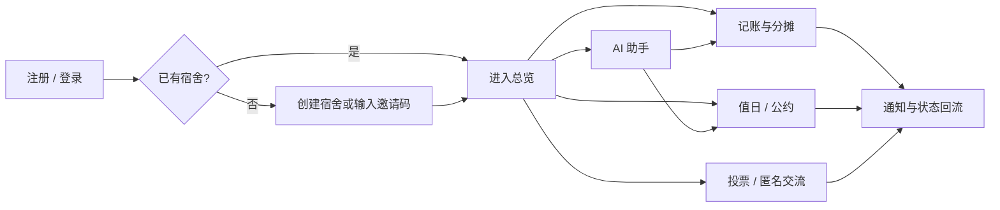
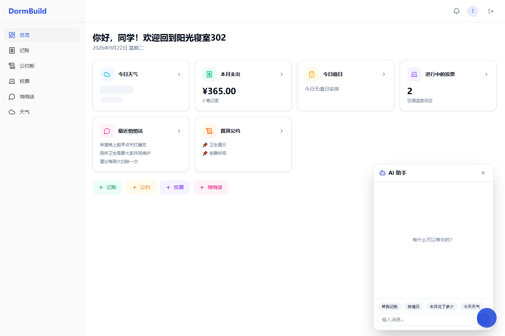
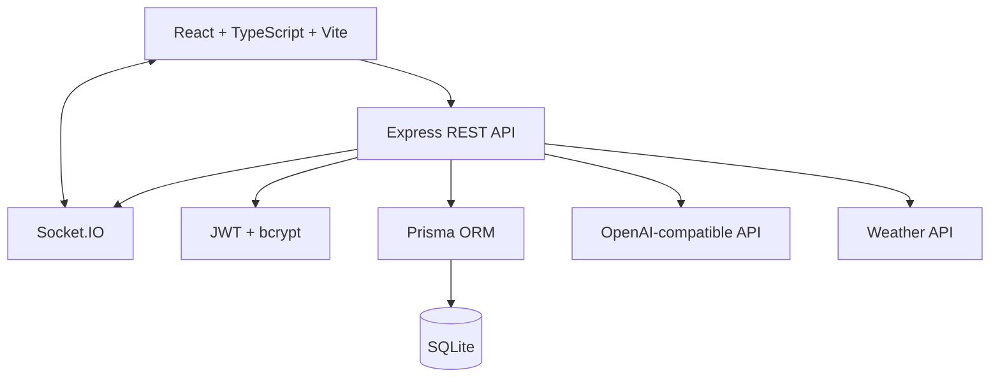

# DormBuild

> A full-stack prototype for managing shared dormitory affairs, from expenses and duty schedules to voting, notifications, and an AI assistant.

面向大学生寝室场景的公共事务管理平台。项目将分散在群聊、口头约定和个人记账中的宿舍事务，收敛到一个可追踪、可协作的统一工作台。

**项目状态：功能型原型｜本地运行｜暂未部署在线版本**



## 为什么做这个项目

多人共同生活时，费用分摊、值日、公约和临时决策往往依赖群聊推进：信息容易被覆盖，责任边界不清，历史记录也难以复盘。DormBuild 将这些高频事务拆成结构化模块，并用通知与 AI 入口降低记录和查询成本。

### 目标用户

- 需要共同管理宿舍费用、卫生和值日安排的大学生
- 希望减少反复催促、口头确认和群聊信息遗漏的寝室成员
- 需要查看历史决策与公共约定的宿舍负责人

## 核心能力

| 模块 | 解决的问题 | 当前实现 |
| --- | --- | --- |
| 宿舍与成员 | 多人如何进入同一协作空间 | 注册登录、创建宿舍、邀请码加入 |
| 公共记账 | 谁付款、如何分摊、是否结清 | 费用分类、均分/自定义分摊、账单与统计 |
| 值日与公约 | 责任如何落到具体成员和日期 | 值日排期、完成状态、置顶公约 |
| 宿舍投票 | 临时决策如何留痕 | 单选/多选、匿名投票、截止时间 |
| 匿名交流 | 不便实名表达的问题如何被看见 | 匿名消息与点赞 |
| 通知与天气 | 重要事项如何及时触达 | 实时通知、值日提醒、天气展示 |
| AI 助手 | 自然语言如何进入事务流程 | 对话入口、费用解析、值日解析接口 |

## 关键产品流程



## 界面预览

| 总览工作台 | AI 助手 |
| --- | --- |
|  |  |

截图来自本地种子数据环境，不是设计稿或虚构页面。

## 系统架构



### 技术栈

- 前端：React 19、TypeScript、Vite、TanStack Query、Zustand、Framer Motion、Recharts
- 服务端：Express、Prisma、Socket.IO、JWT、Zod、node-cron
- 数据与集成：SQLite、OpenAI-compatible API、天气 API
- 工程组织：pnpm workspace，`client` / `server` / `shared` 三包结构

## 本地运行

### 1. 安装依赖

```bash
pnpm install --frozen-lockfile
```

### 2. 创建服务端环境变量

在 `server/.env` 中填写：

```dotenv
PORT=3001
JWT_SECRET=replace-with-a-random-secret
DATABASE_URL=file:./dev.db

OPENAI_API_KEY=your-api-key
OPENAI_BASE_URL=https://api.openai.com/v1
OPENAI_MODEL=gpt-4o-mini

WEATHER_API_KEY=your-weather-api-key
WEATHER_API_BASE_URL=https://devapi.qweather.com/v7
DEFAULT_CITY=北京
```

AI 与天气密钥只影响对应模块；不要提交真实密钥。

### 3. 初始化数据库

```bash
pnpm db:generate
pnpm db:push
pnpm db:seed
```

种子数据提供 `小明 / 小红 / 小刚 / 小丽` 四个本地演示账户，密码均为 `123456`。仅用于本地演示。

### 4. 启动前后端

```bash
pnpm dev
```

- 前端：`http://127.0.0.1:8080`
- 服务端：`http://localhost:3001`

## 目录结构

```text
DormBuild/
├── client/             # React 前端、页面与交互
├── server/             # REST API、Socket.IO、定时任务与 Prisma
├── shared/             # 前后端共享类型与常量
├── docs/images/        # README 使用的真实运行截图
└── pnpm-workspace.yaml
```

## 当前边界

- 当前是本地原型，未提供生产环境部署、监控与数据迁移方案。
- AI 和天气能力依赖使用者自行配置第三方 API。
- 生产构建仍需适配新版 OpenAI SDK 的消息类型定义；本次仓库装修未修改应用代码。
- 权限模型以单个宿舍协作为主，尚未覆盖管理员分级、申诉与审计。

## 后续方向

- 将 AI 解析结果接入“预览—确认—写入”的完整事务闭环
- 增加账单结算提醒、值日冲突检测和投票结果通知
- 补充接口测试、端到端测试和生产部署配置

## 使用说明

本仓库目前用于个人作品展示与产品原型交流，未附开源许可证。
